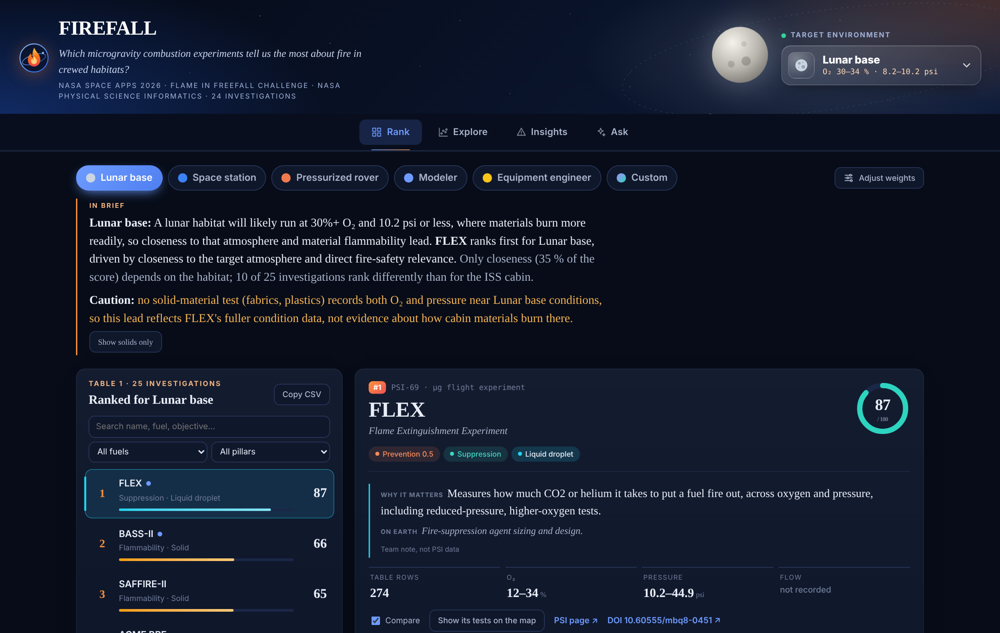
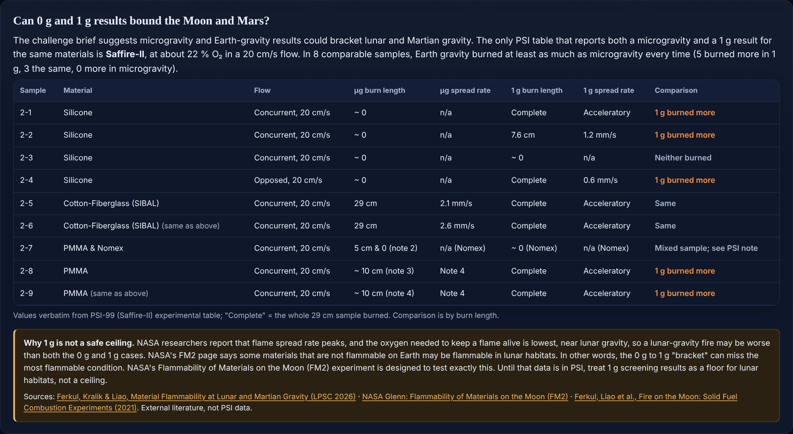
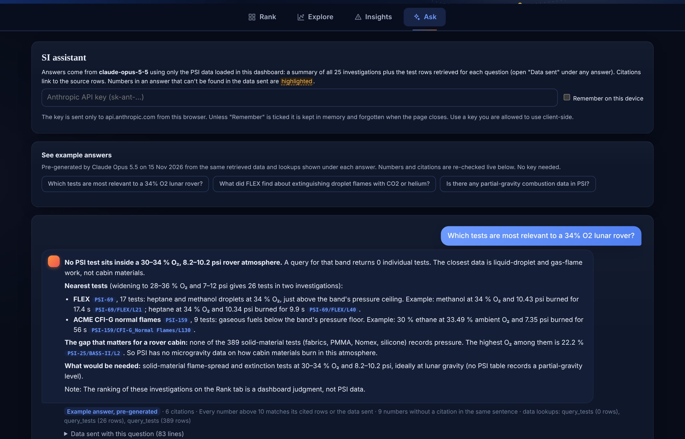

# FIREFALL

**NASA Space Apps Challenge 2026 · *Flame in Freefall* challenge · Team Polymathematics**

FIREFALL is an SI-powered dashboard that turns NASA's microgravity combustion experiments into fire-safety answers for crewed habitats: the ISS, a lunar base, a pressurized rover, or a Mars habitat. It loads all 24 Combustion Science investigations in NASA's Physical Science Informatics (PSI) repository, with 2,009 test rows from the 20 that publish experimental tables, ranks them for the habitat you choose, and shows exactly where NASA's open data stops.

**▶ Try it:** https://hydromagnetics.github.io/firefall-dashboard/ (or download `index.html` and open it in any modern browser; it works offline)

**Demo (7 slides):** [docs/FIREFALL-demo-deck.pdf](docs/FIREFALL-demo-deck.pdf)

## The problem

NASA expects a Moon base to run at 30 % or more oxygen at 10.2 psi or less, more than a 40 % increase in oxygen concentration over Earth's air, which makes materials more flammable (challenge text). Decades of microgravity fire experiments are public in PSI, but they are spread across 24 investigations, 22 experimental tables and inconsistent units, so they are hard to compare against a new habitat atmosphere.

## What we found

- **0 of 389 solid-material tests in PSI were run in a lunar-habitat atmosphere.** None of PSI's tests on fabrics, plastics or Nomex records pressure, and the highest oxygen recorded is 22.2 %. NASA has burned materials at exploration-like conditions in Saffire-IV and V, but those results are not in PSI, the open repository researchers are pointed to.
- **Earth gravity may not be the worst case.** The challenge suggests 0 g and 1 g results could bracket lunar and Martian gravity. In Saffire-II, 1 g burned at least as much as microgravity in all 8 comparable samples, but NASA calls its 1 g screening test (NASA-STD-6001 Test 1) "not conservative", and NASA researchers report flame spread peaking, and the oxygen limit lowest, near lunar gravity. The dashboard shows both.

## What it does

- **Rank:** all 24 investigations scored for a chosen habitat on four visible components (fire-safety pillar, closeness of tested oxygen and pressure to the habitat, directness, data richness). Weights are adjustable, and the dashboard warns when a lead rests on data that says nothing about cabin materials.
- **Explore:** every test plotted by oxygen and pressure; filter, compare variables, and export rows for modeling.
- **Insights:** key findings for lunar and Martian habitats, lessons from past spacecraft fires, the 0 g vs 1 g comparison, data gaps, and the experiments that will fill them (FM2, SoFIE, FLARE, LUCI).
- **Ask:** an SI assistant (Claude) that answers only from the loaded PSI data, runs exact queries for counts and cites individual test rows. The dashboard then re-checks every number in the answer against the cited rows and highlights anything it cannot verify. Three pre-generated, labelled example answers work without a key.

## How we know it is right

- **Every value is traceable.** Each of the 2,009 test rows keeps the PSI file and line it came from. Errors in NASA's spreadsheets are flagged and left empty; the only two recovered values (ACME BRE "3400%" and "2100%", read as 34 % and 21 %) are marked approximate.
- **Ambient vs burner oxygen is separated.** In ACME's inverse flames (274 rows), the oxygen value is the gas leaving the burner, not the surrounding atmosphere. It is stored separately as `o2_burner_frac` and never treated as a habitat atmosphere.
- **Checked against NASA's originals.** All 25 DOIs (the 24 combustion investigations plus ASE, a cabin-aerosol context entry for smoke detection) match PSI's live records; every Saffire-II value matches NASA's CSV; the solid-material tables were re-read from NASA's files.
- **Checkable by anyone.** `python tools/validate.py` re-checks the dataset embedded in `index.html` (Python 3, standard library only). Every outside source, how it was checked, and every correction we made are listed in [docs/sources-and-verification.md](docs/sources-and-verification.md).

## Limitations

- The ranking weights, closeness bands and the 30–34 % O₂, 8.2–10.2 psi lunar target band are team judgments for scoring. They are labelled as such and can be changed; findings quote NASA's own figures.
- FIREFALL covers PSI only. Saffire-IV to VI, FM2, LUCI and SoFIE results are not in PSI yet; the dashboard says so and links NASA's pages.
- PSI holds no partial-gravity data, so the lunar-gravity discussion relies on NASA literature, cited in the dashboard.
- Live questions on the Ask tab need Claude access (an Anthropic API key outside claude.ai). The rest of the dashboard works offline.
- Test rows come from the 20 investigations that publish experimental tables (22 tables). PSI-60, PSI-62, PSI-115 and PSI-117 are analysis and modeling studies with no experimental table; they appear in the ranking from their PSI records only. Images, video and raw sensor files are not parsed.
- The original ingestion scripts are not included; the processed dataset is in `data/` (described in [data/README.md](data/README.md)) and is verified by `tools/validate.py`.

## Repository

| Path | What it is |
| --- | --- |
| `index.html` | The dashboard (app and embedded data in one file) |
| `data/psi_data.json` | The embedded dataset as JSON |
| `data/tests.csv` | Every test row as a flat table (raw text plus low/high numeric values) |
| `data/README.md` | What the data files contain, their provenance and AI acknowledgment |
| `tools/validate.py` | Checks the data in `index.html`; `--export` regenerates `data/` |
| `docs/FIREFALL-demo-deck.pdf` | The 7-slide demo deck |
| `docs/data-sources.md` | The NASA PSI investigations used, with DOIs |
| `docs/sources-and-verification.md` | Every source used, how it was checked, and corrections made |
| `docs/official-challenge-text.txt` | The official challenge text and resource list |
| `docs/img/` | Screenshots used in this README |

## Data and credits

Data: NASA Physical Science Informatics (psi.nasa.gov); NASA places no restrictions on its use, and we cite each investigation by its DOI in [docs/data-sources.md](docs/data-sources.md). Additional NASA sources (the Researcher's Guide to Combustion Science, Saffire, FM2, LUCI and NTRS papers) are cited in [docs/sources-and-verification.md](docs/sources-and-verification.md).

**Use of SI (AI):** The Ask tab uses Claude (Anthropic), an AI model, to answer questions from the loaded PSI data; its answers are labelled and checked by the dashboard. Claude was also used during development to review the dashboard, fix data handling, add panels, write the validator, verify sources, and draft documentation and the demo deck. The same acknowledgment is in the metadata of `index.html`, `data/psi_data.json` (`provenance`), `data/README.md` and the demo deck PDF. No NASA logos, flags or mission identifiers appear in any SI-generated content, and no images were AI-generated (the screenshots are of the dashboard).

**Team:** Polymathematics (NASA Space Apps 2026, Universal Event).

**License:** Code is MIT (see [LICENSE](LICENSE)). NASA data is not covered by this license.
